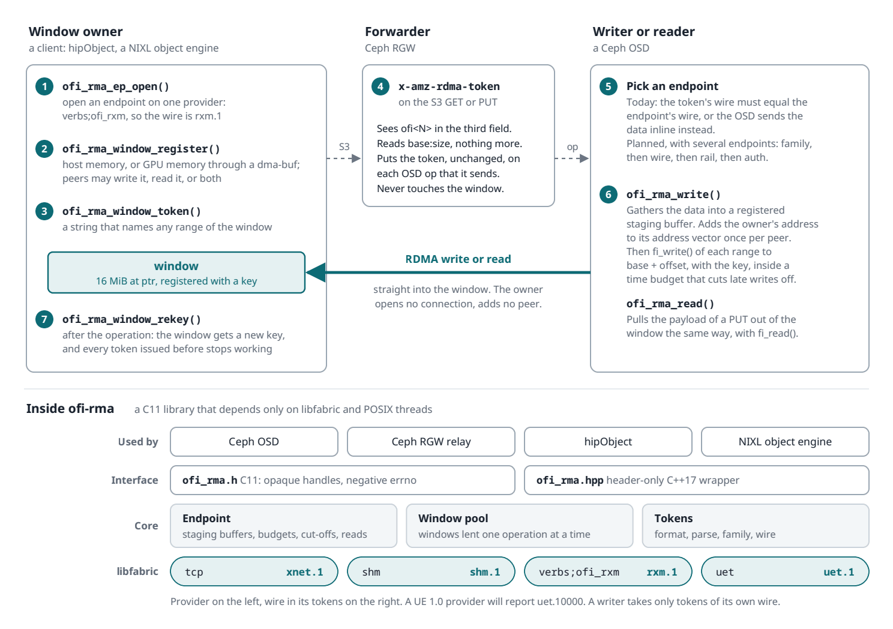
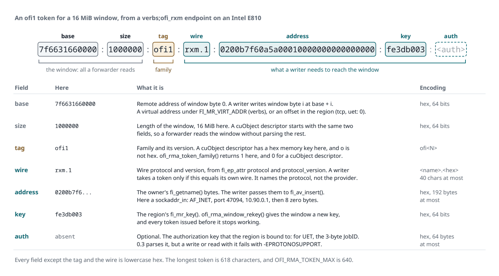

# ofi-rma

ofi-rma moves data out of band into memory that a peer lends, over libfabric. The library is written in C11, and it depends only on libfabric and POSIX threads.

A window owner registers memory and hands out a token that names it. Any writer that holds the token and speaks the same wire protocol writes into that memory. The writer needs no connection to the owner, and the owner never adds the writer to its address vector.

Ceph uses ofi-rma for the out-of-band legs that its OSDs and gateway run. A client of Ceph's S3-over-RDMA data path, such as a NIXL object engine, uses it to lend the memory that the OSDs write into.



## Interfaces

- `ofi_rma/ofi_rma.h` is the C interface. Its functions start with `ofi_rma_`, and they return a negative errno on failure.
- `ofi_rma/ofi_rma.hpp` is a header-only C++17 wrapper in the namespace `ofi_rma`. A C++ program links with the C library only.

This README uses the C++ names. Each one has a C counterpart. For example, `config_t::hmem` is `ofi_rma_config.hmem`, and `Endpoint::hmem()` is `ofi_rma_ep_hmem()`.

## Token format

```
<base>:<size>:ofi1:<wire>:<address>:<key>[:<auth>]
```

- `base` is the remote address of window byte 0, as the owner's provider reads it. That is a virtual address under `FI_MR_VIRT_ADDR` and a region offset otherwise. A writer writes window byte `i` at `base + i`.
- `size` is the length of the window.
- `wire` is the wire protocol and its version, from the provider's `fi_ep_attr`: for example `rxm.1` for `verbs;ofi_rxm`, or `xnet.1` for `tcp`. A writer takes only tokens of its own wire.
- `address` is the owner's `fi_getname()` bytes, at most 192 bytes.
- `key` is the region's `fi_mr_key()`. A provider with keys longer than 8 bytes, or with `FI_MR_RAW`, is refused.
- `auth` is optional: the authorization key that the region is bound to, such as a UET JobID. This version parses it but does not use it yet. A write or read with such a token fails with `-EPROTONOSUPPORT`.

Every field except the tag and the wire is lowercase hex. The token starts with the same `addr:size` fields as a cuObject descriptor. A server that only forwards tokens can read the window size without parsing the rest. `token_family()` tells an `ofi<N>` token from a cuObject descriptor.

The wire names the protocol, not the provider. Two vendors' UET providers thus take each other's tokens. See `doc/wire-tokens.md` for the reasons, and for the way a server picks one of its endpoints for a token.



## Providers

| Provider | Wire | Notes |
|----------|------|-------|
| `tcp` | `xnet.1` | Needs no special hardware. It cannot cut off a late write, so use it for tests only. |
| `shm` | `shm.1` | Works between processes on one host. |
| `verbs;ofi_rxm` | `rxm.1` | RDMA reliable connections on any verbs device. On soft-RoCE, set `FI_UNIVERSE_SIZE=16` in every process. See the notes below. |
| `uet` | `uet.1` | Ultra Ethernet, through a libfabric wrapper for the UEC reference provider. |

A provider with manual progress places incoming data only while the owner polls its endpoint. Set `config_t::progress_thread` for an endpoint that lends windows, or poll it with `progress()`.

Notes for `verbs;ofi_rxm`:

- The verbs provider caches memory registrations by default. With the cache, a region that is closed stays registered, so its key keeps working, and registering the memory again returns the same key. `rekey_window()` then fails with `-EOPNOTSUPP` rather than report a new key. If you re-key windows, or if a deregistered window must revoke its key, set `FI_MR_CACHE_MONITOR=disabled` in the environment before the first libfabric call.
- A write that carries a revoked key is a remote access error, which breaks the reliable connection to that peer. Writes to the peer then fail with `-ECANCELED` until the provider reconnects, a few hundred milliseconds on soft-RoCE.
- If libfabric 2.3.1 closes a `verbs;ofi_rxm` endpoint that still has credit completions queued, it can crash. Upstream commit 697688386 ("prov/rxm: fix the msg_ep use-after-free at connection teardown") fixes it. Until a release has the fix, ofi-rma polls the completion queue of a `verbs;...` endpoint for up to 50 ms, and then closes the endpoint. The provider thus handles those completions first.

## Device memory

A window owner can lend a window in GPU memory. Set `config_t::hmem`, then register the window with a `memory_t` that names the memory kind: `cuda`, `rocr` or `ze`.

- The provider must offer `FI_HMEM`, and `Endpoint::hmem()` says whether it does. Without it, the registration fails with `-EOPNOTSUPP`.
- libfabric itself must have the runtime for that memory kind. A provider can offer `FI_HMEM` while libfabric lacks the runtime, and the registration then fails with `-ENOSYS`. For example, the Fedora libfabric 2.3.1 package has no ROCr support. Run with `FI_LOG_LEVEL=info` to see the memory interfaces that libfabric initialized.
- A writer does not ask for device memory. It writes into a GPU window as into a host window.
- For a NIC to write straight into GPU memory, the provider and the NIC driver must support it, usually through dma-buf. The platform must also give the NIC a PCIe path to the GPU. A software provider such as `shm` copies into the GPU instead.
- If `rekey_window()` or a cut-off registers a window again, the window keeps its memory kind.
- `WindowPool` lends host memory only.

A NIC can write into GPU memory only through a dma-buf: the GPU driver exports the memory, and the RDMA driver registers the export. Set `memory_t::dmabuf_fd` and `memory_t::dmabuf_offset` to a dma-buf that you exported, for example with ROCr's `hsa_amd_portable_export_dmabuf()`, and ofi-rma registers it with `FI_MR_DMABUF`. Keep the fd open while the window is registered. Do it this way rather than leave the export to libfabric, for two reasons:

- libfabric exports ROCr memory only with `FI_HMEM_ROCR_USE_DMABUF=1` and only on a kernel built with `CONFIG_DMABUF_MOVE_NOTIFY=y`. The Fedora 6.19 kernel lacks that option, although `irdma` registers the export without it.
- libfabric 2.3.1 offers `FI_HMEM` on verbs only for devices named `mlx*` or `bnxt_re*`. Upstream commits e755fe9cd and 2a8e74e39, in 2.7.0, add RoCE devices and a per-device dma-buf probe.

If `OFI_RMA_TEST_VERBS_NODE` names a device that takes dma-bufs, the `verbs;ofi_rxm` test writes into a dma-buf window in AMD GPU memory. Over an Intel E810 with `irdma`, the NIC places the data in the GPU memory with no copy.

## Reads

A peer can also pull bytes out of a window, as a Ceph OSD pulls the payload of a PUT out of a client's memory.

- Set `config_t::reads` on both endpoints. `Endpoint::reads()` says whether the provider offers RMA reads. A provider without them still opens the endpoint, for writes only.
- Register a window that peers can read with `register_window(ptr, len, mem, access, &w)`. `access` is a mask of `Endpoint::remote_write` and `Endpoint::remote_read`. The provider fails a read of a window that was registered for writes only.
- `read()` reads into a staging buffer. It copies into the caller's buffers only after every read completed, so a failed read leaves them unchanged. The ranges must cover the caller's buffers exactly once.
- Reads share the staging buffers, the budget and the cut-offs with writes.
- A token for a readable window lets any holder read that memory. When the operation that you lent the window for is complete, re-key the window with `rekey_window()`.

The `verbs;ofi_rxm` GPU test also reads out of a dma-buf window in AMD GPU memory. The GPU verbs tests need a NIC that registers dma-bufs, such as the E810. On soft-RoCE, the dma-buf registration crashes the test process.

The GPU tests in `test/test_ofi_rma_hip.cc` run over `shm` on an AMD GPU. If there is no GPU, or if libfabric has no ROCr support, they skip. To build libfabric with ROCr support, configure it with `--with-rocr=/usr`, or with the path of your ROCm installation.

## Staging in your own memory

A writer copies each transfer into a registered staging buffer. By default an endpoint allocates `stage_count` buffers of `stage_size` bytes itself. A program that runs several transports, and wants one budget of registered memory for all of them, can lend the endpoint its own memory instead:

- Set `config_t::stage_mem` and `config_t::stage_mem_len`. The endpoint registers that memory once, for its own access.
- Set `config_t::stage_alloc` and `config_t::stage_free`. Each transfer takes a buffer of at least its size, at most `stage_size` bytes, and gives it back when no operation can touch it any more. After a cut-off, that can be when the endpoint closes.
- The hooks run with the endpoint's lock held, so they must not call into the endpoint.

Ceph's OSDs use this to stage libfabric and cuObject transfers in one arena.

## Build

You need a C11 compiler and libfabric 1.18 or later, with its headers. The tests also need a C++17 compiler and GoogleTest.

To build and test with CMake:

```
cmake -S . -B build -G Ninja
ninja -C build
ctest --test-dir build
```

To build and test with meson (the `tests` and `hip` options are features, `auto` by default):

```
meson setup build-meson
meson test -C build-meson
```

The CMake build has these options:

| Option | Default for a top-level build | Default under `add_subdirectory` |
|--------|-------------------------------|----------------------------------|
| `OFI_RMA_SHARED` | `ON` | `OFF`: a static library with position-independent code |
| `OFI_RMA_BUILD_TESTS` | `ON` | `OFF` |
| `OFI_RMA_INSTALL` | `ON` | `OFF` |
| `OFI_RMA_HIP` | `AUTO`: if CMake finds the HIP runtime, build the GPU tests | `AUTO`, with tests off |

`unittest_ofi_rma_c` builds the C interface as strict C11 and checks tokens, a write, a read and a window pool over `tcp`. The C++ tests run over `tcp` and `shm`. They skip a provider that is not available. A full run takes about 40 seconds. To also run them over `verbs;ofi_rxm`, set `OFI_RMA_TEST_VERBS_NODE` to the IP address of an RDMA device, such as a soft-RoCE device. The tests then set `FI_UNIVERSE_SIZE=16` and `FI_MR_CACHE_MONITOR=disabled` unless they are already set.

## Use from another project

An installed ofi-rma ships a pkg-config file and a CMake package.

- pkg-config: `pkg-config --cflags --libs ofi-rma`.
- CMake: `find_package(ofi_rma)`, then link `ofi_rma::ofi_rma`.
- CMake, from source: `add_subdirectory(ofi-rma)`, then link `ofi_rma`.
- meson: `dependency('ofi-rma')`. With a wrap file, the dependency also resolves from a subproject.

From C, include `<ofi_rma/ofi_rma.h>`. From C++, include `<ofi_rma/ofi_rma.hpp>` and compile as C++17 or later.

## Origin and license

This code started in Ceph as `src/common/ofi_rma.{h,cc}` and `src/test/common/test_ofi_rma.cc`. The history of those three files came along with them. Version 0.3 ported the library from C++ to C. The C++ interface became a wrapper over the C one.

ofi-rma is licensed under the MIT license. See `LICENSE`. In Ceph the code was under the LGPL. When the code left Ceph, the author of every commit relicensed it under MIT.
