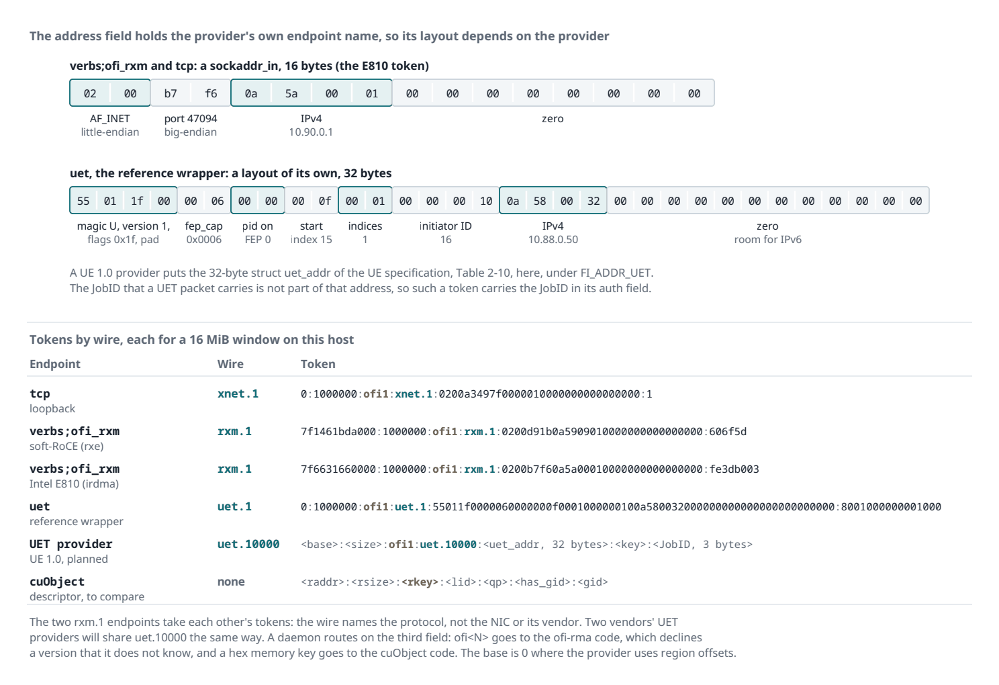

# Tokens that name the wire, and how a server picks its endpoint

This note describes the token format in ofi-rma 0.3. It also describes how a server, such as a Ceph OSD or gateway, maps a token to one of its own endpoints. The last section lists the work that is still open.

## Why the token changed

In 0.2, a token named the libfabric provider, for example `verbs;ofi_rxm`, and a writer accepted only tokens of its own provider. That rule works for verbs, tcp and shm, because one provider implements each of them for every vendor. It fails for Ultra Ethernet. Section 2.2 of the UE specification 1.0.2 fixes the fabric name `UET` and the address format `FI_ADDR_UET` (Table 2-4). It leaves the provider name to each vendor. Two vendors' NICs that speak the same UET profile interoperate on the wire. Under the 0.2 rule, an OSD on one vendor's NIC refuses a token from a client on another vendor's NIC.

The token now names the wire protocol, not the provider. A server then needs one endpoint for each protocol that it accepts, whatever the vendors of its clients' NICs.

## Token format

```
<base>:<size>:ofi1:<wire>:<address>:<key>[:<auth>]
```

Every field except the tag and the wire is lowercase hex.

| Field | Content |
|-------|---------|
| `base` | The remote address of window byte 0, as the owner's provider reads it. A writer writes window byte `i` at `base + i`. |
| `size` | The length of the window. |
| `ofi1` | The family and its version. |
| `wire` | The wire protocol and its version, as `<name>.<version>`. |
| `address` | The owner's `fi_getname()` bytes, at most 192 bytes. |
| `key` | The region's `fi_mr_key()`, at most 64 bits. |
| `auth` | Optional. The authorization key that the region is bound to, at most 64 bytes. For UET, this is the 3-byte JobID. |

The longest token is 618 characters. `OFI_RMA_TOKEN_MAX` is 640.

### The wire field

ofi-rma reads the wire from the provider's `fi_ep_attr`. The name comes from `protocol` and the version from `protocol_version`, in hex. Examples:

| Provider | `protocol` | Wire |
|----------|------------|------|
| `verbs;ofi_rxm` | `FI_PROTO_RXM`, version 1 | `rxm.1` |
| `tcp` | `FI_PROTO_XNET`, version 1 | `xnet.1` |
| `shm` | `FI_PROTO_SHM`, version 1 | `shm.1` |
| Any UET provider | `FI_PROTO_UET`, `FI_VERSION(1, 0)` | `uet.10000` |

The protocol values are part of libfabric's ABI, and libfabric only adds to them. ofi-rma keeps its own table of the values, so the names do not depend on the libfabric headers that a program builds against.

libfabric does not define `FI_PROTO_UET` yet. If the fabric name of an endpoint is `UET`, in any case, ofi-rma names the endpoint `uet`. This rule covers UET providers until libfabric defines the value. The UEC reference provider wrapper reports the fabric name `uet` and protocol version 1, so its wire is `uet.1`.

If a provider reports a protocol that is not in the table, the wire name is `proto` and the value in hex. If a provider reports no protocol, the wire name is `prov_` and the provider name. In the provider name, every character other than a letter or a digit becomes `_`.

If the token's wire equals the writer's own wire, version included, the writer accepts the token. Otherwise, the writer refuses it.

The figure below shows the address field of two providers, and a token from each wire. The tokens came from endpoints on one test host, each for a 16 MiB window.



### The auth field

The UET packet carries a 24-bit JobID, and the target NIC accepts a write only with a JobID that the region authorizes. The endpoint address does not contain the JobID, so the token must carry it. The JobID grants nothing by itself: the writer's kernel driver allows a process only the JobIDs that the provisioning system assigned to it.

In 0.3, ofi-rma parses and formats the auth field, but it does not use it yet. A write or read with a token that has an auth field fails with `-EPROTONOSUPPORT`, and nothing is sent. Endpoints never put an auth field in their own tokens.

### Families and old daemons

A cuObject descriptor starts with the same `addr:size` fields. Its third field is its memory key in hex. The tag `ofi1` starts with `o`, which is not a hex digit, so the two families cannot be confused. `ofi_rma_token_family()` returns `N` for a token whose third field is `ofi<N>`, and 0 for any other descriptor. A daemon must route on this value, so that a token of an unknown version is declined. It must not send such a token to the cuObject code.

A 0.2 daemon still parses a 0.3 token without an auth field: `rxm.1` is a valid provider name to it. It finds that the name is not its provider, and it serves the data inline. A 0.2 daemon rejects a token with an auth field, because the token has seven fields. A 0.3 daemon rejects a 0.2 token, because a provider name such as `verbs;ofi_rxm` is not a valid wire.

## How a server picks its endpoint

A token describes only the client. It must not name a server endpoint: a Ceph gateway forwards the token to whichever OSDs CRUSH selects, and the client cannot know their endpoints. Each daemon maps a token to one of its own endpoints in four steps.

1. Family. If the third field is hex, give the token to the cuObject executor. If it is `ofi<N>` and the daemon knows `N`, go to step 2. Otherwise, serve the data inline.
2. Wire. Find the daemon's endpoints for the token's wire. If there are none, serve the data inline.
3. Rail. Of those endpoints, use the one on the interface that routes to the client's IP address, which the address field contains for verbs and UET. If no route decides, use round robin.
4. Authorization. If the token has an auth field, add the peer to the address vector with that key (`FI_AV_AUTH_KEY`). If the endpoint cannot, serve the data inline.

A daemon's configuration lists its endpoints as `wire@domain`, for example `rxm.1@ice0, rxm.1@ice1, uet.10000@uet0`. Each OSD publishes the wires that it serves in its OSD metadata. Before a gateway passes a token through, it compares the token's wire with the wires that every OSD serves. If any OSD lacks the wire, the gateway goes straight to the HTTP body, or to its staged mode for a cuObject descriptor.

## The library is written in C

ofi-rma 0.3 is a C11 library. It depends only on libfabric and POSIX threads, and it does not need the C++ standard library.

- `ofi_rma/ofi_rma.h` is the C interface. Its functions start with `ofi_rma_`. They return 0, or a count, on success and a negative errno on failure. Handles are opaque.
- The configuration and statistics structures start with a `size` field. The library reads and writes only that many bytes, so a program built against an older header keeps working with a newer library.
- Test callbacks are function pointers with a context pointer, in `struct ofi_rma_hooks`.
- `ofi_rma/ofi_rma.hpp` is a header-only C++17 wrapper. It keeps the 0.2 C++ interface, with two changes: `token_t::provider` is now `token_t::wire`, and `token_t` has an `auth` field. `Endpoint::wire()` is new, and `Endpoint::name()` returns a copy, since a cut-off can change the name.

## Open work

- JobID support. If the provider offers `FI_AV_AUTH_KEY`, open the domain with it. Key the peer table by address and auth key. Put the auth field into the tokens of regions that are bound to a JobID. The UE specification requires the multi-JobID method only for the HPC profile. On an AI Full NIC without it, a server needs one endpoint per client job.
- Several endpoints per Ceph daemon, with the configuration and the selection steps above.
- The gateway's wire check before passthrough.
- The UET wrapper. It must report the fabric name `UET` and the protocol version `FI_VERSION(1, 0)`. When libfabric defines `FI_PROTO_UET`, the wrapper must report it. Its address must be the 32-byte `struct uet_addr` of UE specification Table 2-10, under `FI_ADDR_UET`. Its address layout today is its own, so its tokens do not work with a conforming provider.
- Reads need the AI Full or HPC profile. OSD-direct PUT pulls from the client's memory, so the OSD can check the profile bits in the client's UET address before it tries a pull.
